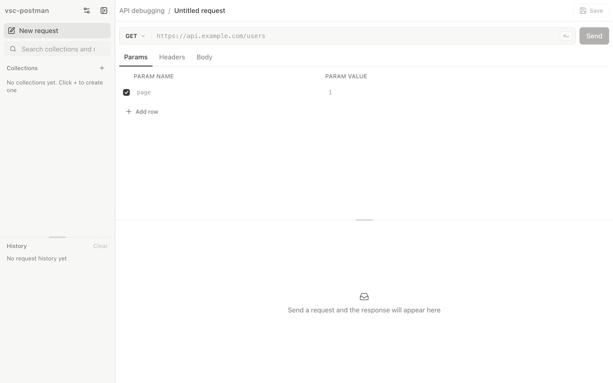
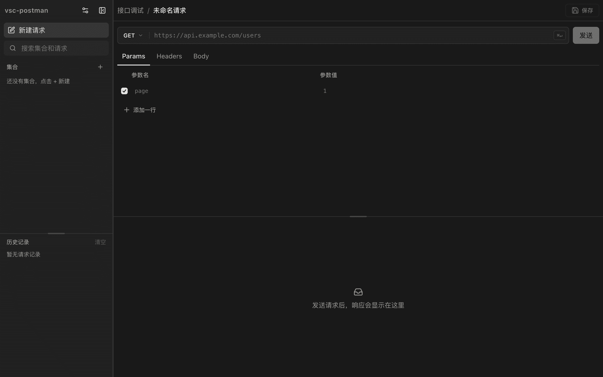

# vsc-postman

- **免登录**：没有账号、注册、邀请码、云端工作区。装完打开就能发请求。
- **数据在本地**：集合、历史、设置只写进浏览器的 `localStorage` 或 VS Code 的扩展存储，不上传、不同步、不经过任何服务器。
- **一套 UI，三个宿主**：VS Code 侧边栏与编辑器标签、浏览器扩展（Edge / Chrome 等 Chromium 内核浏览器）、普通 Web 页面，共享同一份 React 代码。
- **调试力不打折**：Query / Headers / 四种请求体 / 不限大小的流式文件上传 / SSE 事件流边收边看。

## 界面预览

左边是集合与历史，右边是请求编辑器：选方法、填 URL、切 `Params / Headers / Body`，发送后响应在下方展开。浅色 / 深色跟随宿主主题，界面中英文可切换。上面两张是同一页面的浅色英文与深色中文状态（都是新建请求、尚未发送的初始界面）。

## 为什么是它

现成的接口调试工具大多默认你会注册一个账号，把集合同步到它们的云上——这对公司内网系统、带真实 Token 的请求、客户环境地址来说，常常是不可接受的。vsc-postman 把这条链路砍掉：

| 你的关注点          | 这里的行为                                                        |
| ------------------- | ----------------------------------------------------------------- |
| 要不要注册          | 不要。没有账号体系，也没有「登录以同步」的引导                    |
| 数据去了哪          | 只在本机。Web/扩展用 `localStorage`，VS Code 用 `globalState`     |
| 会不会被统计        | 没有埋点、没有遥测 SDK、没有远程配置                              |
| 会不会偷偷存 Cookie | 不会。请求固定 `credentials: 'omit'`，扩展也不申请 `cookies` 权限 |
| 会不会加载远程代码  | 不会。扩展 CSP 限定 `script-src 'self'`，所有代码随包分发         |

## 功能

- HTTP 方法：`GET / POST / PUT / PATCH / DELETE / HEAD / OPTIONS`
- Query 参数、自定义 Headers、`JSON / Text / x-www-form-urlencoded / form-data` 请求体
- `form-data` 文本与文件混排、同名多文件、流式转发不限制大小、可随时取消；开发代理显示上传进度
- 响应状态码、耗时、大小、Headers、正文；JSON 格式化 / 原始视图 / 一键复制
- **SSE 事件流**：`text/event-stream` 边收边展示，左侧原始项 + 右侧解析内容分栏，支持取消并保留已收事件
- 集合管理：新建、重命名、删除、复制请求、跨集合移动、搜索过滤
- 历史记录：默认最近 50 条，可在设置页调到 10–500；连续重复请求只留一条
- 浅色 / 深色主题（`system` 跟随系统或 VS Code 主题）、中英文界面、`⌘/Ctrl + Enter` 发送
- 存储页可视化查看当前持久化内容，并可复制为 JSON

## 体积

三个宿主都随包分发完整前端，不依赖 CDN、不加载远程脚本，装好断网也能用。

| 产物                 | 下载体积   | 解包后 | 文件数 | 内容                                          |
| -------------------- | ---------- | ------ | ------ | --------------------------------------------- |
| VS Code 扩展 `.vsix` | **398 KB** | 1.3 MB | 29     | 扩展宿主 JS + 同一份 Webview 前端             |
| 浏览器扩展 zip       | **360 KB** | 1.1 MB | 8      | MV3 清单 + Service Worker + 同一份前端 bundle |
| 共享 Web UI `dist/`  | —          | 1.1 MB | 7      | 同时作为 VS Code Webview 的 `media/` 资源     |

## License

[MIT](./LICENSE)
