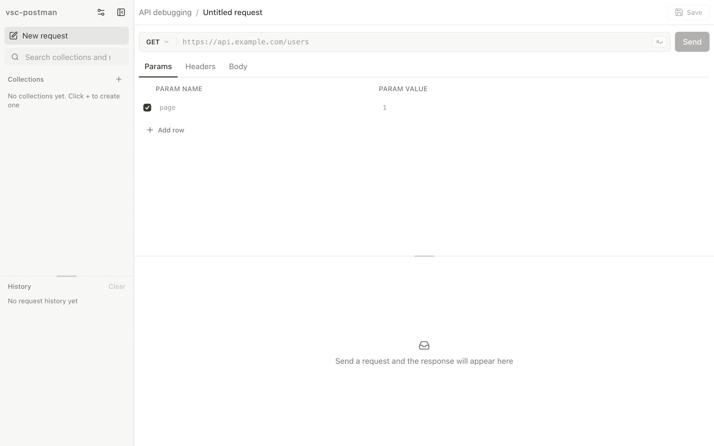
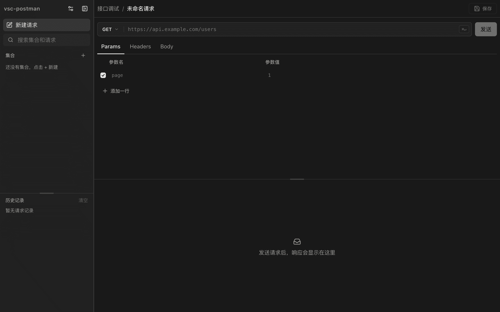

# vsc-postman

## 为什么用它

- **免登录**：没有账号体系，也没有「登录以同步」的引导。
- **数据在本地**：集合、历史、设置写入 `localStorage`，不上传、不同步。
- **无埋点**：不含分析或崩溃上报 SDK，不加载远程代码（CSP `script-src 'self'`）。
- **不碰 Cookie**：请求固定 `credentials: 'omit'`，不申请 `cookies` 权限。
- **不受页面 CORS 限制**：请求由扩展的 Service Worker 发出。

## 界面

扩展以独立标签页打开，没有侧边栏挤压：左边集合与历史，右边选方法、填 URL、切 `Params / Headers / Body`，响应在下方展开。浅色 / 深色与中英文界面都在设置里切换。

## 功能

- 请求：`GET / POST / PUT / PATCH / DELETE / HEAD / OPTIONS`，Query、自定义 Headers
- 请求体：JSON、纯文本、`x-www-form-urlencoded`、`form-data`
- `form-data` 文本与文件混排、同名多文件、流式转发不限大小、可随时取消
- 响应：状态码、耗时、大小、Headers、正文；JSON 格式化 / 原始视图 / 一键复制
- **SSE 事件流**：边收边展示，左侧原始报文、右侧解析事件，取消后保留已收内容
- 集合与历史：分组、复制、跨集合移动、搜索过滤；历史默认 50 条，可调 10–500
- 浅色 / 深色主题、中英文界面、`⌘/Ctrl + Enter` 发送

## 体积

扩展 zip **360 KB**（解包 1.1 MB，8 个文件）：`manifest.json`、Service Worker `background.js`（2 KB）、应用页 `app.html`，其余几乎全是一份约 1.03 MB 的前端 JS（gzip 332 KB）加 56 KB 的 CSS（gzip 9.8 KB）。没有字体文件、没有截图素材（图标 12 KB）、没有 sourcemap，也不在运行时下载任何代码——CSP 为 `script-src 'self'`。

## 权限说明

| manifest 字段                               | 用途                                                                   |
| ------------------------------------------- | ---------------------------------------------------------------------- |
| `host_permissions: http://*/*, https://*/*` | 调试对象是任意 HTTP 接口，域名无法预先枚举；仅在你点击发送时用于该请求 |
| `background.service_worker`                 | 承载请求执行，使请求不受页面 CORS 限制                                 |
| `action`                                    | 工具栏图标点击后打开应用页面                                           |

**未申请**：`cookies`、`tabs`、`storage`、`webRequest`、`scripting`、`declarativeNetRequest`。

- 不注入 content script，不读取任何网页内容。
- 不声明 `side_panel`：应用是普通扩展页面，不占用浏览器侧边栏。
- 打开标签页使用 `chrome.tabs.create()`，因此无需 `tabs` 权限。

## 数据与隐私

- 集合、历史、设置保存在扩展页面的 `localStorage`；清除该扩展的浏览数据即全部删除。
- 请求从你的浏览器直接发往你填写的地址；没有账号、没有云同步、没有后台轮询。
- Headers 可能包含 Token，为明文存储；`form-data` 只记录文件元信息，不保存文件内容。
- 当前只有导出、没有导入（设置页可查看并复制持久化内容）。
- Service Worker 发出的请求带 `Origin: chrome-extension://<id>`，部分服务端会据此限制访问。
- 完整说明：[Privacy & data handling](https://github.com/bingcoder/vsc-postman/blob/master/docs/privacy.md)

## 反馈

问题与建议：[Issues](https://github.com/bingcoder/vsc-postman/issues)

## License

[MIT](https://github.com/bingcoder/vsc-postman/blob/master/LICENSE)

---

# vsc-postman

## Why this

- **No sign-in**: no account system, and no "sign in to sync" prompts.
- **Data stays local**: collections, history and settings are written to `localStorage`. Nothing is uploaded or synced.
- **No telemetry**: no analytics or crash-reporting SDK, no remote code loading (CSP `script-src 'self'`).
- **No cookies touched**: requests are fixed to `credentials: 'omit'`; the `cookies` permission is never requested.
- **No page-level CORS limits**: requests are sent by the extension's Service Worker.

## Interface

The extension opens as a full tab, so nothing squeezes the UI: collections and history on the left, method, URL and `Params / Headers / Body` on the right, response below. Light/dark and Chinese/English are switched in Settings.

## Features

- Requests: `GET / POST / PUT / PATCH / DELETE / HEAD / OPTIONS`, with Query params and custom headers
- Bodies: JSON, plain text, `x-www-form-urlencoded`, `form-data`
- `form-data` with text and files mixed, multiple files per field, streamed without size limits, cancellable at any time
- Responses: status code, duration, size, headers, body; JSON formatting / raw view / one-click copy
- **SSE streams**: displayed as they arrive, raw events on the left and parsed events on the right; cancelling keeps what was already received
- Collections and history: grouping, duplicate, move across collections, search filter; latest 50 history entries by default, adjustable from 10 to 500
- Light/dark theme, Chinese and English UI, `⌘/Ctrl + Enter` to send

## Size

The extension zip is **360 KB** (1.1 MB unpacked, 8 files): `manifest.json`, the `background.js` service worker (2 KB), the `app.html` entry page, and essentially one front-end bundle of about 1.03 MB of JavaScript (332 KB gzipped) plus 56 KB of CSS (9.8 KB gzipped). No fonts, no screenshot assets (the icon is 12 KB), no source maps, and no code downloaded at runtime — the CSP is `script-src 'self'`.

## Permissions

| Manifest field                              | Purpose                                                                                                                  |
| ------------------------------------------- | ------------------------------------------------------------------------------------------------------------------------ |
| `host_permissions: http://*/*, https://*/*` | The debugging target can be any HTTP API, so domains cannot be enumerated in advance; used only for the request you send |
| `background.service_worker`                 | Runs requests so they are not subject to page CORS                                                                       |
| `action`                                    | Opens the app page when the toolbar icon is clicked                                                                      |

**Not requested**: `cookies`, `tabs`, `storage`, `webRequest`, `scripting`, `declarativeNetRequest`.

- No content script is injected and no page content is read.
- No `side_panel`: the app is a regular extension page and does not occupy the browser sidebar.
- Tabs are opened with `chrome.tabs.create()`, so no `tabs` permission is needed.

## Data & privacy

- Collections, history and settings live in the extension page's `localStorage`; clearing this extension's browsing data removes everything.
- Requests go straight from your browser to the URL you typed; no account, no cloud sync, no background polling.
- Headers may contain tokens and are stored in plain text; `form-data` only records file metadata, never file contents.
- Currently export-only, no import (the settings page lets you view and copy the persisted data).
- Requests sent by the Service Worker carry `Origin: chrome-extension://<id>`; some servers restrict access based on that header.
- Full details: [Privacy & data handling](https://github.com/bingcoder/vsc-postman/blob/master/docs/privacy.md)

## Feedback

Questions and suggestions: [Issues](https://github.com/bingcoder/vsc-postman/issues)

## License

[MIT](https://github.com/bingcoder/vsc-postman/blob/master/LICENSE)
